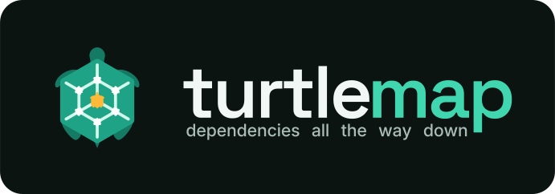

<h1 align="center"></h1>

Turtlemap shows a Python, JavaScript or TypeScript codebase as pictures
instead of text. It was built to make code easier to follow for people with
dyslexia, but it works for anyone who wants a map of unfamiliar code.

It runs on your machine and never sends your code anywhere.

## Quick start

```bash
poetry install --with dev
poetry run turtlemap path/to/project
```

This opens Turtlemap in your browser. Leave out the folder to pick a project,
or a recent one, on the start screen. To try it on itself, run
`poetry run turtlemap .` from this repository.

| Option | What it does |
|---|---|
| `folder` | The project to open |
| `--diff RANGE` | Highlight what changed in a git range ([see below](#comparing-git-revisions)) |
| `--port N` | Use a fixed port instead of a free one |
| `--no-open` | Print the address instead of opening your browser |

## Three views

### The map

Your code as nested boxes: packages, modules, classes, functions, fields and
constants. Click a box to open it.

Arrows show how things depend on each other. Each arrow is one of seven kinds:
**inherits**, **has a field of**, **creates**, **calls**, **reads**, **writes**
and **uses**.

- **Thicker arrows** stand for more dependencies. One-off links are faded.
- **Arrows only join neighbours**, boxes inside the same parent. Inside an open
  box, faint feeder lines carry each dependency to the box's edge.
- **Hover** over an item to light its whole path. Hover over an arrow to see
  what it is made of.
- **Shortcuts** (A → C when A already reaches C through B) are drawn very
  faintly, and their card names the way round.
- **Arrows flow left to right.** Only a real cycle loops back, in its own lane.
- **Select a module** to hide every module that is not linked to it.
  **✕ Show all** brings them back.
- **Libraries** are one box each, and the standard library gets one box.
- **Show** in the corner hides test files or constants.

The code panel under the map shows the real source, folded to match what you
have opened.

### The data model

Press **▦ Data** for an entity–relationship diagram of your dataclasses,
models and enums.

- Each class lists its fields. A line joins a field to the class it holds.
- The ends of each line show how many:

  | End | Means |
  |---|---|
  | Two bars | exactly one |
  | Circle and bar | zero or one (`Optional`) |
  | Crow's foot | many (a list, set, tuple or dict) |

- Classes that link to each other are grouped together.
- The view opens on the package you were looking at. Pick another in the list
  at the top.
- A project with more than 250 data classes asks you to pick a package first.

### The blueprint

Click a function to see it as a dataflow graph, in the style of Unreal Engine
blueprints.

- **Each value is a wire**, coloured by its type.
- **A white line** marks where the order of steps matters.
- **⧉ on a call** unfolds the called function in place. **Go into** makes it
  the whole view.
- **Hover over a wire** to see both ends and its full type.
- **Maths stays readable.** `total = price * quantity * (1 + tax)` is one node
  named `total`, with the expression written out.
- **Nested functions and lambdas** are frames drawn around their own body.
- **Shared variables that change** get a node of their own, with Get and Set
  steps.

The code panel highlights the line behind whichever node you select.

### Getting around

- Press `/` to find any file, class or function.
- When you hover over something, lines that lead off screen get a marker on
  the edge of the view. Click a marker to glide there.
- The **Code** tab hides, shows or resizes the code panel.

## Reading settings

The cog menu changes the label font (Lexend, Atkinson Hyperlegible, Comic
Neue or monospace), the text size, the background, and whether names are
spaced out.

It also picks the layout:

| Layout | What you get |
|---|---|
| Balanced (default) | Each node sits near the middle of its wires |
| Classic | The original layout; more wires bend |
| Compact | The shortest blueprints, with fewer straight wires |
| Straighter | Long straight runs, packed tightly |
| Straightest | The most straight wires, in taller blueprints |

On the map, Balanced and Classic look the same.

## Privacy

- Turtlemap reads your code but never imports or runs it.
- The server listens only on `127.0.0.1` and needs a token made at launch.
- The only outbound request is for web fonts from Google Fonts. Offline, it
  uses system fonts.

## Large projects

The first time you open a large project it takes a while to read. A monorepo of
about 2,700 modules takes around 15 seconds.

The result is cached in `~/.cache/turtlemap` until a file changes. Press
**↻ Reload** after editing code. Blueprints are built when you open them.

## Comparing git revisions

Press **± Compare** and type a git range, or start with one:

```bash
poetry run turtlemap path/to/project --diff develop...my-branch
```

| Range | Compares |
|---|---|
| `A..B` | the tips of A and B |
| `A...B` | B with where it branched off A, like a pull request |
| `A` | A with your working copy, including uncommitted files |

Everything shows the newer side. Things that were removed are added back so
you can see them go.

| Colour | Badge | Meaning |
|---|---|---|
| Green | `+` | added |
| Red | `−` | removed |
| Yellow | `~` | changed, or something inside it changed |

The colours appear on the map, the file tree, blueprints and the code. A call
turns yellow when the function it calls changed. The panel under the map lists
every changed file.

### Ticking off what you have reviewed

While comparing, the left panel has a **Changes** tab that lists only the
changed files, like a pull request.

- Each file opens into the parts that changed: functions, methods, class
  bodies and module-level code.
- Tick a part, file or folder to mark it seen. The ✓ **Seen** box does the
  same for what you are looking at.
- If a part changes again later, only that part is unticked.

Seen marks are saved in `~/.config/turtlemap/seen`.

## Comments

Select something and press **C** to comment on it:

- **On the map**, click a box. ⌘/Ctrl-click adds more, and Shift-drag selects
  a group.
- **In a blueprint**, the same with nodes.
- **In the code panel**, drag down the line numbers.

Comments show as 💬 pins. The **Comments** tab lists them, and `[` and `]` step
through the open ones.

- Only you can resolve a comment.
- A line comment follows its code when lines move, and is marked *outdated*
  when that code changes.
- Comments are saved in `~/.config/turtlemap/comments`.

### Working with a coding agent

An agent working on the same branch can read and answer your comments. It can
reply and mark a comment seen, working or done, but it cannot resolve it. You
see its replies and status live.

`turtlemap-agent` is the command-line way in. Run it through Poetry from this
repository; an alias saves typing:

```bash
alias turtlemap-agent='poetry -C /path/to/this/repo run turtlemap-agent --root "$PWD"'
```

```bash
turtlemap-agent watch            # one line per new comment, reply or resolve
turtlemap-agent show c3          # the thread and the code it points at
turtlemap-agent working c3 --note "updating plots.py"
turtlemap-agent reply c3 "Split it into two functions"
turtlemap-agent done c3
turtlemap-agent status "running the tests"
```

In Claude Code, run `turtlemap-agent watch --once` as a background command. It
exits when there are new comments, which wakes the agent. Start it again after
handling them.

`turtlemap-mcp` offers the same tools over MCP:

```bash
claude mcp add turtlemap -- poetry -C /path/to/this/repo run turtlemap-mcp --root /path/to/project
```

While Turtlemap runs, it saves its address and a separate agent token in
`~/.config/turtlemap/servers`, readable only by you.

### Asking about the structure

The agent can also ask about the code:

```bash
turtlemap-agent query report                 # every module, the most coupled pairs, what is too large
turtlemap-agent query describe pkg/plots.py  # what it contains, its size, its links
turtlemap-agent query cohesion Plotter        # a class, module, package or function
turtlemap-agent query coupling pkg/a.py pkg/b.py
turtlemap-agent query blueprint Plotter.draw  # a function's nodes and wires as text
turtlemap-agent query tree pkg --depth 3
turtlemap-agent query find plot
```

Names can be paths, dotted modules, `Class.method` or map ids. Every answer
explains how it was worked out:

| Measure | How it is worked out |
|---|---|
| Class cohesion | LCOM4: groups of methods that share no field and don't call each other |
| Module and package cohesion | Linked groups of members, and internal links ÷ all links |
| Function cohesion | Independent dataflow strands (a rough guide) |
| Coupling | Links between two parts, weighted by kind |
| Instability | Ce ÷ (Ca + Ce), leaving tests out of Ca |
| Size | Flags anything too large (see below) |

Size flags:

| Thing | Too large when it has more than |
|---|---|
| Folder | 15 files and folders, or 6,000 lines |
| File | 500 lines, or 40 classes and functions |
| Class | 300 lines, or 20 methods |
| Function | 50 lines, or a complexity of 15 |

Tests are left out of the size checks.

## Languages

| Language | Read with | Files |
|---|---|---|
| Python | `ast` | `.py` |
| JavaScript and TypeScript | tree-sitter | `.js`, `.jsx`, `.mjs`, `.cjs`, `.ts`, `.tsx` |

- `.d.ts` and minified files are skipped.
- Imports resolve through relative paths, `index` files, `export *`, `require`
  and the `paths` in `tsconfig.json`.
- Plain scripts in the same folder see each other's top-level names.
- JSX elements count as calls, so a component links to what it renders.

Functions without names are named after where they appear:

| Code | Name |
|---|---|
| `const save = async () => {…}` | `save` |
| `const onClick = useCallback(() => {…}, [])` | `onClick` |
| `const api = { load() {…} }` | `api.load` |
| `describe("parsing", () => {…})` | `describe(parsing)` |
| `items.forEach((item) => {…})` | `forEach(callback)` |

To add a language, write a front end that parses it into the shared model and
a table of its builtins, operators and type names.

## Development

```bash
poetry run mypy .
poetry run pytest tests
```

To measure how straight the wires are, open a project, paste
[dev/layout-stats.js](dev/layout-stats.js) into the browser console, and
compare the numbers before and after a layout change.

### How it fits together

Each language is parsed into one shared model of the code. Everything after
that (the map, blueprints and queries) works only on the model.

| Part | What it does |
|---|---|
| `languages/` | Front ends that parse each language into the model |
| `analysis/model.py` | The shared model of the code |
| `analysis/workspace/` | Finds source files and resolves names across them |
| `analysis/symbols.py` | Lists each module's classes, fields, functions and constants |
| `analysis/dependencies.py` | Builds the arrows on the map |
| `analysis/blueprint/` | Builds a function's blueprint |
| `analysis/outline.py` | Builds the folded code under the map |
| `analysis/structure.py`, `analysis/metrics/` | Answer the agent's structure questions |
| `analysis/diff/` | Compares two git revisions |
| `projects/` | Opens projects, caches them and remembers what you have seen |
| `review/` | Stores comments and works out where they point |
| `web/` | The local server |
| `static/` | The browser app, as plain JavaScript modules |
| `app.py` | The `turtlemap` command |
| `agent.py`, `mcp.py` | The `turtlemap-agent` and `turtlemap-mcp` commands |
| `config.py` | Where settings and caches are kept |

## License

Turtlemap is free software under the
[GNU Affero General Public License v3.0 or later](LICENSE). If you run a
changed version for other people over a network, you must offer them its
source.
